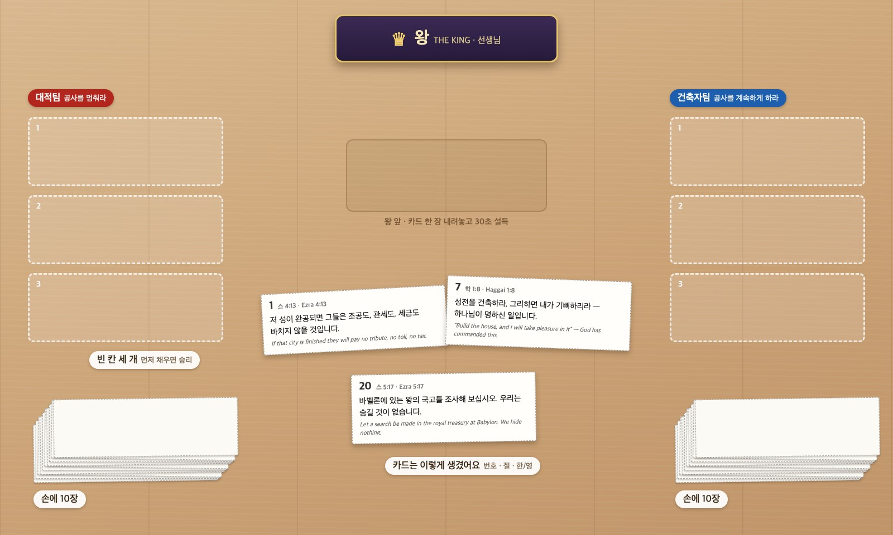
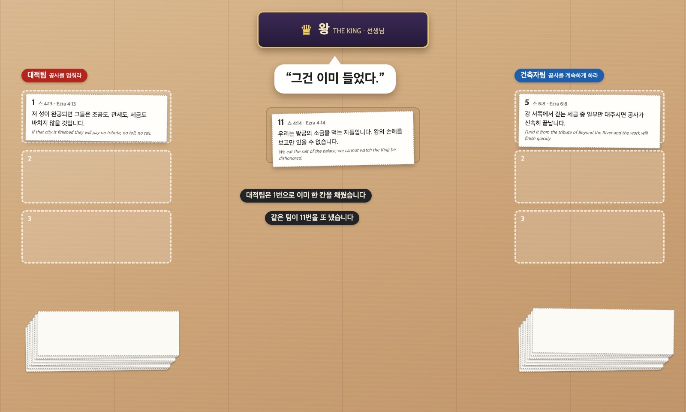
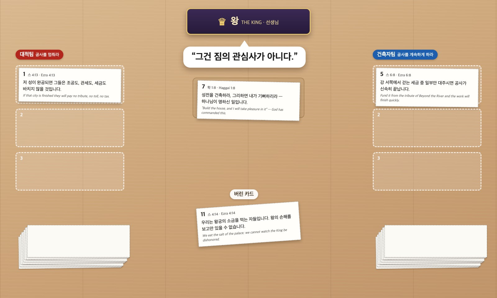
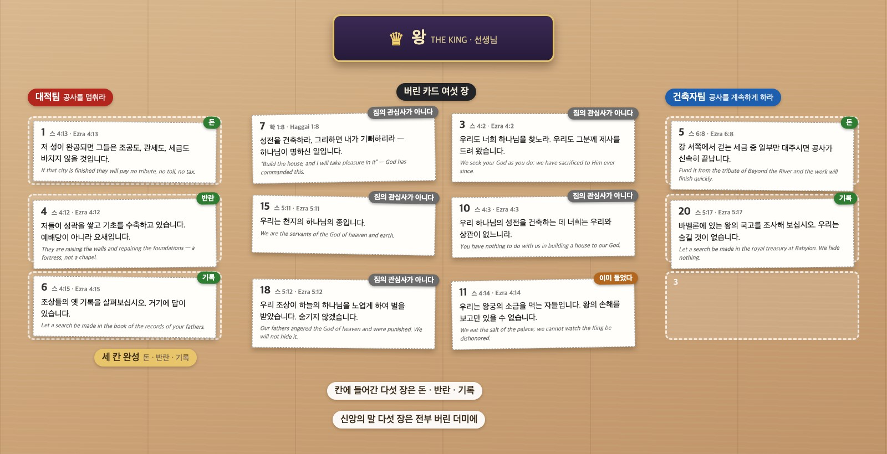

# 그 편지에는 '하나님'이 한 번도 나오지 않는다 — 에스라 4~6장

카드게임 · 20분 · 학생 4명(2:2)과 선생님 1명 · 블로그 글: <https://salt-light.tistory.com/55>

A 20-minute card game on Ezra 4–6: two teams try to persuade a bored Persian king, and the cards that look strongest to church kids are the ones he throws away.

성전 재건을 막으려던 사람들이 페르시아 왕에게 보낸 고발 편지가 에스라 4장 11-16절에 통째로 실려 있습니다. 한번 세어보세요. 그 편지에 '하나님'이라는 단어가 몇 번 나오는지.

한 번도 나오지 않습니다. 조공, 관세, 세금, 반역, 옛 기록. 그게 전부예요. 명백한 종교 갈등이었는데도요.

이 관찰 하나로 중고등부 아이들 넷과 20분짜리 게임을 만들었습니다.

## 준비물

카드 20장. 종이에 인쇄해서 자르면 끝입니다. 20장 전부 에스라 4-6장(과 학개 1장)에 나오는 말을 카드 말투로 옮긴 것이고, 카드마다 절 번호가 적혀 있어요.

그리고 각 팀 앞에 빈 칸 세 개. 접시 세 개든 포스트잇 세 장이든 상관없습니다.

## 역할 나누기

- 학생 2명 = **대적팀**. 미션은 "왕을 설득해서 공사를 멈춰라."
- 학생 2명 = **건축자팀**. 미션은 "왕을 설득해서 공사를 계속하게 하라."
- 선생님 1 = **왕**

## 게임 방법

카드를 섞어서 각 팀에 10장씩 나눠줍니다. 작전회의 2분, 그리고 교환 타임 2분. 두 팀이 만나서 1:1 맞교환만 가능합니다. 무작위로 나눠줬으니 대적팀 손에 건축자 카드가 들어가 있거든요. "이거 필요해?"라고 묻는 순간 상대에게 정보가 새는데, 그것도 게임의 일부입니다.

본게임은 간단합니다. 두 팀이 번갈아 카드 한 장 내려놓고 30초 설득. 그게 전부예요.

## 핵심: 규칙을 안 알려줍니다

아이들에게는 "세 칸을 먼저 채우면 이긴다"만 말해줍니다. 왕은 세 마디 중 하나로만 답해요.

- **"…계속해 보라"** → 성공. 카드가 그 팀 칸에 들어갑니다.
- **"그건 이미 들었다"** → 실패. 버립니다.
- **"그건 짐의 관심사가 아니다"** → 실패. 버립니다.

숨은 규칙은 이렇습니다. 카드는 **돈 / 반란 / 기록** 세 종류로 나뉘고, 세 종류를 하나씩 모아야 이깁니다. 같은 종류를 두 번 내면 "이미 들었다"로 버려져요.

이 두 번째 대사가 이 게임의 발명품입니다. 아이들이 돈 얘기로 성공한 뒤 또 돈 카드를 냈다가 "이미 들었다"를 듣는 순간, "아 종류가 있구나"를 스스로 깨닫습니다. 설명 없이 게임이 가르쳐줘요.

위 그림에서 대적팀은 1번(조공과 세금)으로 한 칸을 채웠고, 이어서 11번(왕의 손해)을 냈습니다. 둘 다 돈 이야기라 11번은 버려집니다.

왕은 지루한 표정으로 앉아 있으면 됩니다. "예루살렘? 그게 어디였더라." 아이들이 "왜요?"라고 물으면 이렇게 답하세요. "짐이 그대들에게 설명할 이유가 있는가."

## 그리고 헛카드 다섯 장

아무 종류에도 속하지 않는 카드가 다섯 장 섞여 있습니다. 3, 7, 10, 15, 18번이고, 본문의 이 구절들에서 왔어요.

- "우리도 너희 같이 너희 하나님을 찾노라" (4:2)
- "너희는 우리와 상관이 없느니라" (4:3)
- "성전을 건축하라 그리하면 내가 그것으로 말미암아 기뻐하고" (학 1:8)
- "우리는 천지의 하나님의 종이라" (5:11)
- "우리 조상들이 하늘에 계신 하나님을 노엽게 하였으므로" (5:12)

전부 성경에 있는 신앙의 말입니다. 그리고 교회 아이들 눈에는 이게 덱에서 제일 강해 보이는 카드예요. 그래서 냅니다. 그리고 왕이 하품하며 말하죠. **"그건 짐의 관심사가 아니다."**

카드가 버려지는 그 순간, 아이들 표정이 바뀝니다. 오늘 수업의 절정이 여깁니다.

## 마지막 3분, 공개

게임이 끝나면 정답표를 보여주고 4장 11-16절을 같이 읽습니다.

읽기 전에 버린 카드를 책상 가운데에 펼쳐 놓으세요. 손에 남은 헛카드가 있으면 그것도 같이 내려놓게 합니다. 칸에 들어간 카드는 돈, 반란, 기록 이야기뿐이고, 신앙의 말은 전부 버린 쪽에 모여 있습니다. 아이들이 방금 만든 이 책상이 4장의 편지와 같은 모양이에요.

**첫째, 20장 전부 본문에서 나왔다.** 아이들이 방금 한 건 게임이 아니라 본문 그 자체였다는 것.

**둘째, 버려진 카드도 다 성경이다.** 틀린 말이라서 버려진 게 아니라, **왕에게 한 말이 아니었기 때문에** 버려진 겁니다. "우리도 너희 같이 너희 하나님을 찾노라"는 성전 앞에서 한 말이고, 왕에게 보낸 편지에는 신 이야기가 한 줄도 없어요.

**셋째, 반전.** 대적들은 왕에게 옛 기록을 살펴보라고 요구했습니다(4:15). 자기들에게 유리할 거라 확신했죠. 그런데 건축자들도 똑같이 요청합니다(5:17). 그래서 다리오가 정말로 기록보관소를 뒤지고, 악메다 궁성에서 고레스의 조서가 발견됩니다(6:1-2). 결과는 이 명령이었어요.

> "왕의 재산 곧 유브라데 강 건너편에서 거둔 세금 중에서 그 경비를 이 사람들에게 끊임없이 주어 그들로 멈추지 않게 하라" (스 6:8)

대적들이 사는 그 지역 세금으로 성전을 완공하라는 겁니다. 방해하려고 요청한 조사가, 방해하는 사람들의 돈으로 성전을 세웠어요.

## 물어볼 것

**"'하나님이 명하셨습니다'가 버려질 때 기분이 어땠어? 그 말이 틀린 말이었을까, 아니면 듣는 사람이 달랐던 걸까?"**

**"왕은 하나님을 몰랐고 끝까지 자기 이익만 챙겼는데, 결과는 성전 완공이었어. 이걸 어떻게 봐야 할까?"**

아이들이 "그럼 신앙 얘기는 하면 안 되는 거네요"로 가면 5장 11절을 짚어주세요. 건축자들은 "우리는 천지의 하나님의 종이라"고 먼저 말했습니다. 숨긴 게 아니라 번역한 거예요.

에스라 4장은 방해받는 이야기, 5장은 다시 시작하는 이야기, 6장은 그 방해가 재료가 되는 이야기입니다.

## 자료

- [`ezra-4-6-persuade-the-king.docx`](ezra-4-6-persuade-the-king.docx): 팀 미션 카드 2장, 왕 카드, 정답표, 카드 20장(한/영), 진행 시트가 한 파일에 들어 있어요. 인쇄해서 자르면 바로 쓸 수 있습니다.
- 진행 시트에는 둘째 선생님 역할(재무대신)이 적혀 있습니다. 없어도 게임이 도는 역할이라 위 진행에서는 뺐어요.

그림 속 카드는 인쇄된 카드 그대로이고, 카드를 낸 순서는 예시 한 판입니다.

성경 본문: 성경전서 개역개정판 © 대한성서공회.
