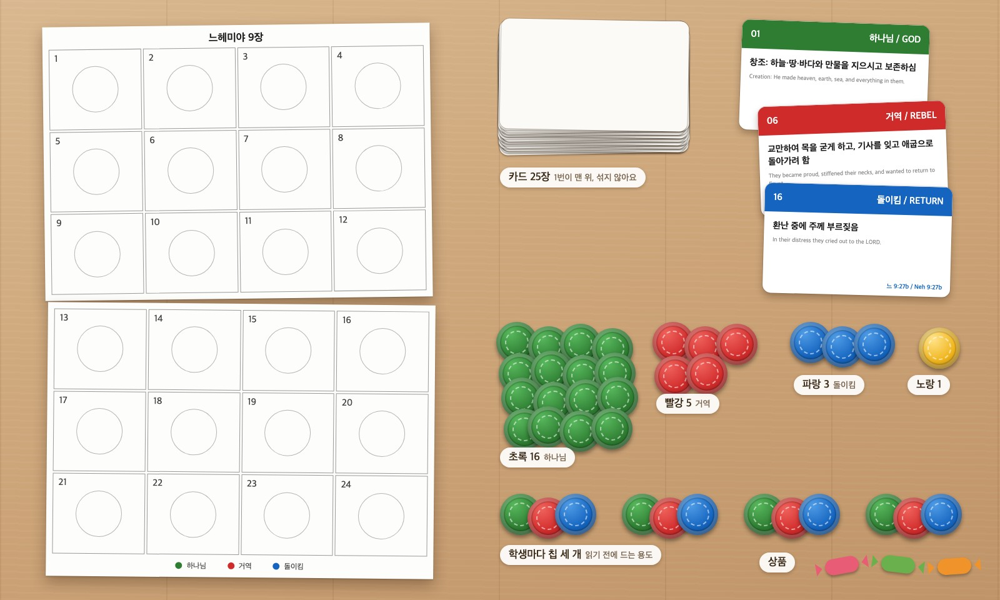
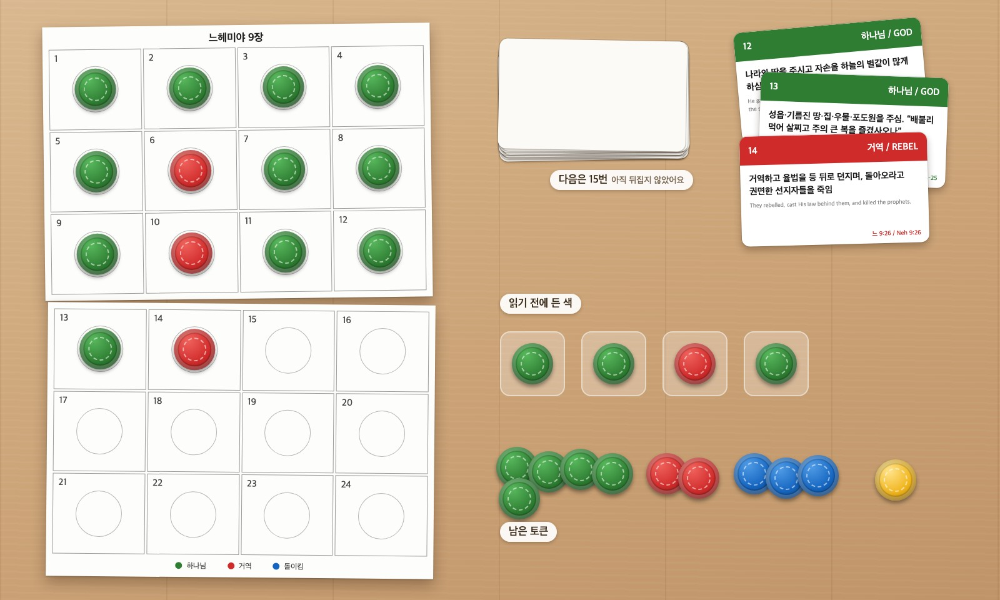
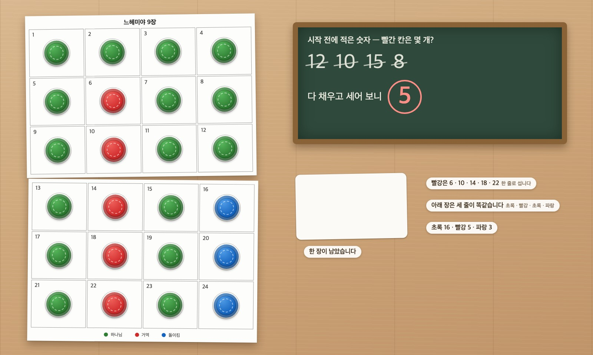
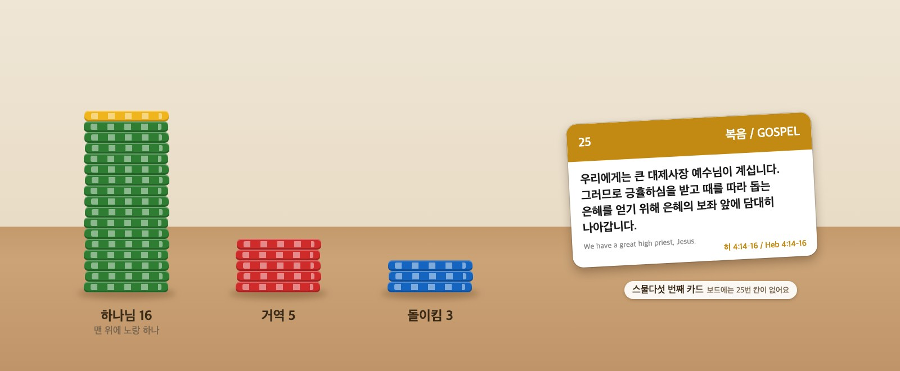

# 스물네 조각 중 열여섯이 하나님 차례였다 — 느헤미야 9장

보드게임 · 20분 · 학생 4명과 선생님 1명 · 설교 뒤에 하는 활동

A 20-minute board game on Nehemiah 9: students guess the color of each of 24 event cards before it is read, and the finished board shows how much of the prayer is God's patience.

느헤미야 9장에는 레위 사람들이 백성을 대표해 드린 기도가 통째로 실려 있습니다. 6절부터 33절까지, 사건 하나에 한 줄씩 잘라 보세요. 그리고 각 줄에 표시해 보세요. 하나님이 하신 일인가, 우리가 등진 일인가, 우리가 돌이킨 일인가.

스물네 조각이 나옵니다. 하나님이 열여섯, 등진 것이 다섯, 돌이켜 부르짖은 것이 셋. 그리고 등진 다섯 조각은 서로 한 번도 붙어 있지 않고, 그 다음 조각은 예외 없이 하나님입니다.

이 관찰 하나로 중고등부 아이들 넷과 20분짜리 보드게임을 만들었습니다.

## 준비물

24칸 보드 한 장(A4 두 쪽), 카드 25장, 토큰. 인쇄해서 자르면 끝입니다. 보드 두 쪽은 위아래로 붙여 놓으세요. 1번부터 24번까지 한 줄에 네 칸씩 내려갑니다.

토큰은 세 색입니다. **초록 = 하나님, 빨강 = 거역, 파랑 = 돌이킴.** 초록 열여섯, 빨강 다섯, 파랑 셋이면 딱 맞고, 노란 토큰 하나는 따로 빼 두세요. 학생마다 세 색 칩을 한 세트씩 나눠주고, 맞힌 사람에게 줄 상품은 사탕이나 스티커로 준비하세요. 보드에 놓는 토큰과 헷갈리지 않게 다른 물건으로요.

카드 스물네 장은 전부 느헤미야 9장을 사건 순서대로 잘라 한두 줄로 줄인 것입니다. 지어낸 사건은 없어요. 스물다섯 번째 한 장만 히브리서입니다.

## 게임 방법

카드를 1번부터 순서대로 뒤집어 쌓아 둡니다. 섞지 않아요. 기도가 흘러가는 순서 그대로 가야 하거든요.

한 장씩 넘기는데, **읽기 전에** 아이들이 세 색 칩 중 하나를 골라 동시에 듭니다. "다음은 하나님일까, 우리가 등진 것일까, 돌이킨 것일까." 그다음 카드를 읽고, 해당 색 토큰을 보드의 그 번호 칸에 놓습니다. 맞힌 사람에게 상품 하나.

첫 장은 선생님이 시범으로 놓아주세요. 1번은 창조입니다(9:6). 하나님이 주신 것이니 초록. 24장, 한 장에 25초쯤이면 10분에 판이 찹니다.

## 시작 전에 숫자 하나

게임을 시작하기 전에 딱 하나 물어보세요.

**"이 보드 24칸 중에 빨간 칸이 몇 개일 것 같아? 숫자로 적어봐."**

아이들은 이스라엘을 '계속 반역한 민족'으로 알고 있어서 절반쯤 부를 겁니다. 그 숫자를 칠판 구석에 적어두고 시작하세요. 답은 다섯입니다. 오늘 수업의 절정은 판이 다 찬 뒤 이 숫자를 다시 볼 때입니다.

## 핵심: 카드를 읽기 전에 색부터 듭니다

정답을 알려주고 놓게 하면 이건 그냥 정리 작업이에요. 읽기 전에 색을 들게 하면 아이가 매 칸 판단을 내리고, 그 판단의 근거가 중간에 바뀝니다.

틀렸을 때가 오히려 좋습니다. 2번 카드(아브람을 택하심, 9:7-8)에서 빨강을 드는 아이가 나올 거예요. 창조 다음엔 아담과 하와가 와야 한다고 생각하거든요. 이렇게 답해주세요.

**"맞아, 성경에서는 하나님이 만드신 다음에 아담과 하와가 반역하지. 그런데 이 기도는 그걸 건너뛰고 바로 아브람으로 가. 그러니까 초록이야."**

이 기도가 무엇을 골라 고백했는지가 여기서 드러납니다.

위 그림은 14번까지 놓고 15번 카드를 뒤집기 직전입니다. 방금 14번이 빨강이었어요. 이쯤 가면 아이들이 카드를 안 보고도 맞히기 시작할 겁니다. 빨강 다음에는 초록이 온다는 걸 판에서 이미 두 번 봤으니까요. 그때 한 번 물어보세요.

**"지금 기억나서 맞힌 거야, 아니면 그냥 그럴 것 같아서 맞힌 거야?"**

"그럴 것 같아서요"가 나오면 그대로 두세요. 마지막에 다시 씁니다.

## 다 채우고 나면

판을 다 놓고 색을 보게 하세요. 세 가지가 눈에 보입니다.

**빨강이 한 줄로 서 있습니다.** 빨간 칸은 6·10·14·18·22번, 다섯 개입니다. 네 칸마다 하나씩이라 보드에서는 왼쪽에서 둘째 세로줄에 나란히 섭니다. 두 개가 붙어 있는 자리가 한 번도 없어요. 그리고 빨간 칸 다음은 예외 없이 초록입니다. 바로 건져내신 자리도 있고(7, 11), 넘기시거나 참으신 자리도 있지만(15, 19, 23), 빈 칸은 없습니다.

**아래 장은 가로 세 줄이 똑같습니다.** 초록, 빨강, 초록, 파랑. 주시고, 등지고, 넘기시고, 부르짖고. 26절부터 31절까지 같은 일이 세 번 돌았다는 것이 그대로 보여요. 아이들에게 "아래 세 줄에서 뭐가 보여?" 하고 물어보세요.

**초록이 열여섯 칸입니다.** 칠판에 적어둔 숫자를 다시 보세요. 우리가 등진 자리보다 하나님이 참으신 자리가 세 배 넓습니다.

왜 그럴 수 있었는지는 기도가 직접 말합니다.

> "주의 크신 긍휼로 그들을 아주 멸하지 아니하시며 버리지도 아니하셨사오니 주는 은혜로우시고 불쌍히 여기시는 하나님이심이니이다" (9:31)

## 스물다섯 번째 카드

24번 칸을 짚어주세요. 오늘 이 사람들이 서 있는 자리입니다. "우리는 악을 행하였사오나"(9:33)라고 고백하면서, 같은 기도 안에서 "이제 작게 여기지 마옵소서"(9:32)라고 구합니다. 고백과 부탁이 한 칸에 같이 있어요.

**"이스라엘 사람들, 여기서 완벽해졌을까?"**

38절에서 이들은 서약을 문서로 쓰고 도장까지 찍습니다. 13장에 가면 그 서약이 다시 깨져요. 판을 보면 아이들도 압니다. 색은 계속 돌아갑니다.

**"그럼 다음 칸은 무슨 색일까?"**

아이들은 패턴대로 초록이라고 답할 겁니다. 맞아요. 그런데 보드에 25번 칸이 없습니다. 카드만 한 장 남아 있어요.

25번 카드를 뒤집습니다. 히브리서 4장 14-16절, "긍휼하심을 받고 때를 따라 돕는 은혜를 얻기 위하여 은혜의 보좌 앞에 담대히 나아갈 것이니라." 17번 칸에서 하나님은 "구원자들"을 주셨습니다(9:27). 여럿이었고, 그들은 죽었어요. 그래서 판이 한 바퀴 돌 때마다 새로 필요했습니다. 이번엔 한 분입니다.

보드의 토큰을 색깔별로 모아 쌓아 보세요. 초록이 열여섯, 빨강이 다섯, 파랑이 셋입니다. 이렇게 오래 참으시는 하나님입니다. 초록 탑 맨 위에 노란 토큰 하나를 올리고, 여기서 끝냅니다.

## 물어볼 것

**"중간부터는 카드를 안 보고도 색을 맞혔지? 그거 기억이었어, 아니면 지금까지 나온 게 그랬으니까 그럴 거라고 생각한 거야?"**

**"24번 카드는 '우리가 악을 행하였습니다'랑 '작게 여기지 마옵소서'가 한 칸에 같이 있어. 너는 잘못한 다음에 하나님한테 부탁까지 할 수 있어?"**

아이들이 "그럼 예수님 믿으면 이제 빨간 칸은 안 나오는 거네요"로 가면 요한일서 2장 1절을 짚어주세요. "만일 누가 죄를 범하여도 아버지 앞에서 우리에게 대언자가 있으니." 범하여도, 라고 쓰여 있습니다. "그럼 우리 죄는 별거 아니네요"로 가면 14번 카드와 36절 "우리가 오늘날 종이 되었는데"를 짚어주세요.

느헤미야 9장은 6절부터 25절까지가 하나님이 주시는 이야기, 26절부터 31절까지가 같은 일이 반복되는 이야기, 32절부터가 그 반복을 다 아는 사람들이 그래도 입을 여는 이야기입니다.

## 자료

- [`nehemiah9-board-24.pdf`](nehemiah9-board-24.pdf): 24칸 보드. A4 두 쪽에 4×3칸씩, 아래에 색 범례(하나님 / 거역 / 돌이킴)가 있어요.
- [`nehemiah9-cards-25.pdf`](nehemiah9-cards-25.pdf): 카드 25장(한/영). A4 한 쪽에 3×4장씩, 카드마다 번호와 절이 적혀 있어요.

그림은 실제 보드와 카드의 색, 번호, 문구를 옮겨 그린 것이고, 칠판의 숫자와 아이들이 든 칩은 예시입니다. 아이들 반응은 예상으로 적었습니다("~할 겁니다").

성경 본문: 성경전서 개역개정판 © 대한성서공회.
