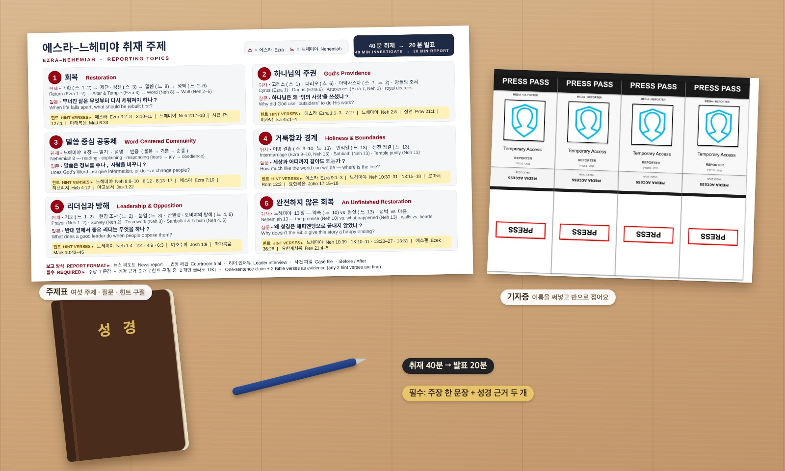
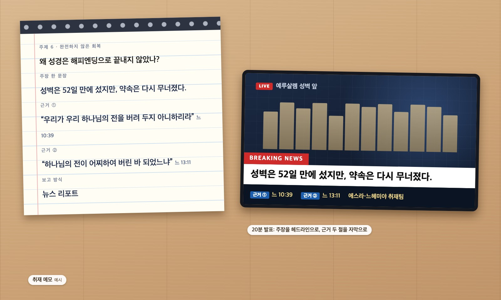

# Breaking News: 에스라–느헤미야

기자 취재와 보도 · 60분(취재 40분 + 발표 20분) · 학생 4명 · 블로그 글: <https://salt-light.tistory.com/60>

A 60-minute wrap-up of Ezra–Nehemiah: each student becomes a reporter, investigates one of six topics for 40 minutes, and reports for 20 minutes with one claim and two verses as evidence.

에스라와 느헤미야 두 책을 여섯 주제로 나눴습니다. 아이들은 기자증을 달고 주제 하나를 맡아 40분 동안 본문을 취재하고, 20분 동안 보도합니다. 조건은 하나예요. **주장 한 문장과 성경 근거 두 개.**

## 준비물

- 기자증(PRESS PASS). 학생 수만큼 이름을 써넣어 목에 걸게 합니다.
- 주제표. 아래 여섯 주제를 화면에 띄우거나 인쇄합니다(한/영).
- 성경.

## 진행

1. 기자증을 나눠줍니다.
2. 주제표를 보여주고 주제를 맡깁니다. 맡기는 방법은 반 인원에 맞춰 정하세요.
3. **취재 40분.** 주제마다 취재 범위, 질문 하나, 힌트 구절이 적혀 있습니다. 힌트 구절에서 시작하면 돼요.
4. **발표 20분.** 보고 방식은 아래 다섯 가지 중에서 고릅니다.

## 주제 여섯 개

### 1. 회복 · Restoration

- 취재: 귀환(스 1–2) → 제단·성전(스 3) → 말씀(느 8) → 성벽(느 2–6)
- 질문: **무너진 삶은 무엇부터 다시 세워져야 하나?** When life falls apart, what should be rebuilt first?
- 힌트 구절: 스 3:2–3, 3:10–11 · 느 2:17–18 · 시 127:1 · 마 6:33

### 2. 하나님의 주권 · God's Providence

- 취재: 고레스(스 1) · 다리오(스 6) · 아닥사스다(스 7, 느 2) · 왕들의 조서
- 질문: **하나님은 왜 '밖의 사람'을 쓰셨나?** Why did God use "outsiders" to do His work?
- 힌트 구절: 스 1:1–3, 7:27 · 느 2:8 · 잠 21:1 · 사 45:1–4

### 3. 말씀 중심 공동체 · Word-Centered Community

- 취재: 느헤미야 8장. 읽기 · 설명 · 반응(울음 → 기쁨 → 순종)
- 질문: **말씀은 정보를 주나, 사람을 바꾸나?** Does God's Word just give information, or does it change people?
- 힌트 구절: 느 8:8–10, 8:12, 8:13–17 · 스 7:10 · 히 4:12 · 약 1:22

### 4. 거룩함과 경계 · Holiness & Boundaries

- 취재: 이방 결혼(스 9–10, 느 13) · 안식일(느 13) · 성전 정결(느 13)
- 질문: **세상과 어디까지 같아도 되는가?** How much like the world can we be — where is the line?
- 힌트 구절: 스 9:1–3 · 느 10:30–31, 13:15–18 · 롬 12:2 · 요 17:15–18

### 5. 리더십과 방해 · Leadership & Opposition

- 취재: 기도(느 1–2) · 현장 조사(느 2) · 분업(느 3) · 산발랏과 도비야의 방해(느 4, 6)
- 질문: **반대 앞에서 좋은 리더는 무엇을 하나?** What does a good leader do when people oppose them?
- 힌트 구절: 느 1:4, 2:4, 4:9, 6:3 · 수 1:9 · 막 10:43–45

### 6. 완전하지 않은 회복 · An Unfinished Restoration

- 취재: 느헤미야 13장. 약속(느 10)과 현실(느 13), 성벽과 마음
- 질문: **왜 성경은 해피엔딩으로 끝내지 않았나?** Why doesn't the Bible give this story a happy ending?
- 힌트 구절: 느 10:39, 13:10–11, 13:23–27, 13:31 · 겔 36:26 · 계 21:4–5

## 핵심: 주장 한 문장과 근거 두 절

질문에 답을 길게 쓰게 하면 아이들은 본문을 요약합니다. 한 문장으로 주장하게 하고 근거를 두 절만 고르게 하면, 어느 절을 버리고 어느 절을 남길지 스스로 판단해야 해요.

위 그림은 6번 주제로 만들어 본 예시입니다. 주장은 "성벽은 52일 만에 섰지만, 약속은 다시 무너졌다." 근거는 "우리가 우리 하나님의 전을 버려 두지 아니하리라"(느 10:39)와 "하나님의 전이 어찌하여 버린 바 되었느냐"(느 13:11)입니다.

## 보고 방식

뉴스 리포트 · 법정 재판 · 리더 인터뷰 · 사건 파일 · Before / After

News report · Courtroom trial · Leader interview · Case file · Before / After

## 필수 조건

**주장 한 문장 + 성경 근거 두 개.** 힌트 구절 중 두 개만 골라도 됩니다.

One-sentence claim + 2 Bible verses as evidence (any 2 hint verses are fine).

## 자료

- [`topics-kr-en.pdf`](topics-kr-en.pdf): 주제 여섯 개를 한 장에 담은 주제표(한/영). 화면에 띄우거나 인쇄하세요.
- [`press-pass-blank.pdf`](press-pass-blank.pdf): 이름 칸이 빈 기자증 네 장. 인쇄해서 반으로 접으면 앞면은 기자증, 뒷면은 PRESS가 됩니다.

그림 속 취재 메모와 뉴스 화면은 예시입니다.

성경 본문: 성경전서 개역개정판 © 대한성서공회.
