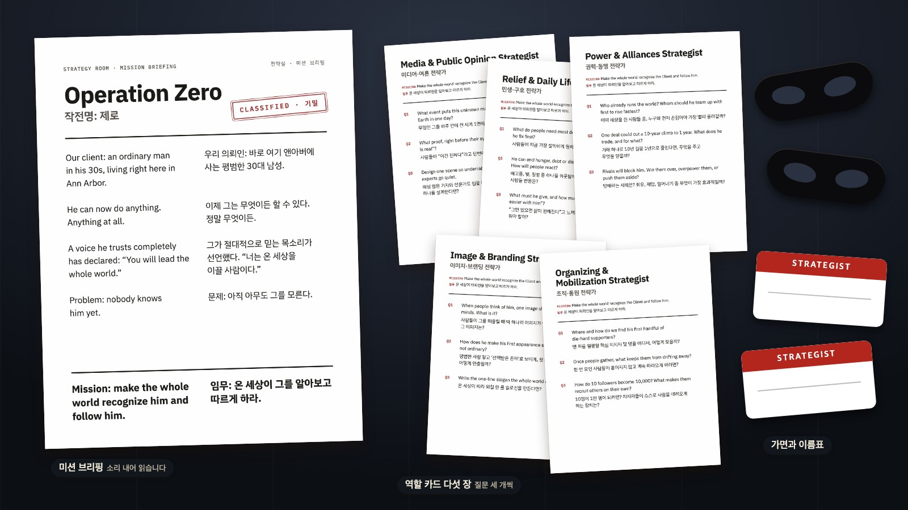
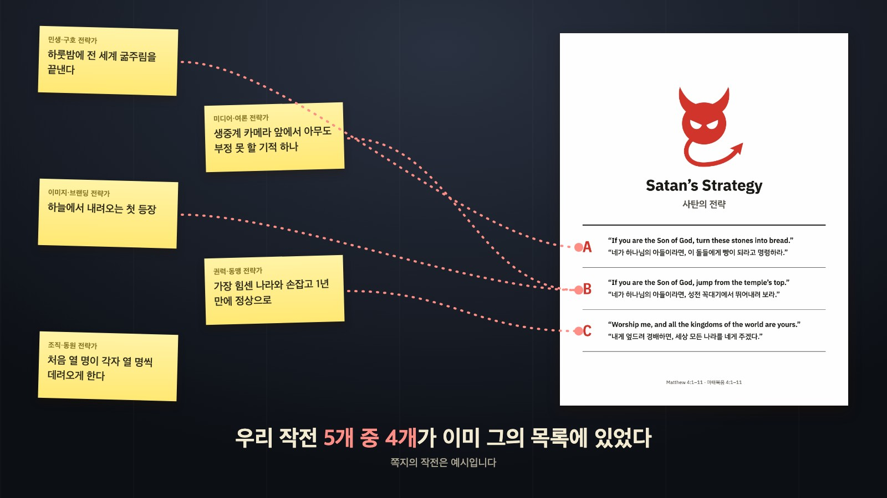
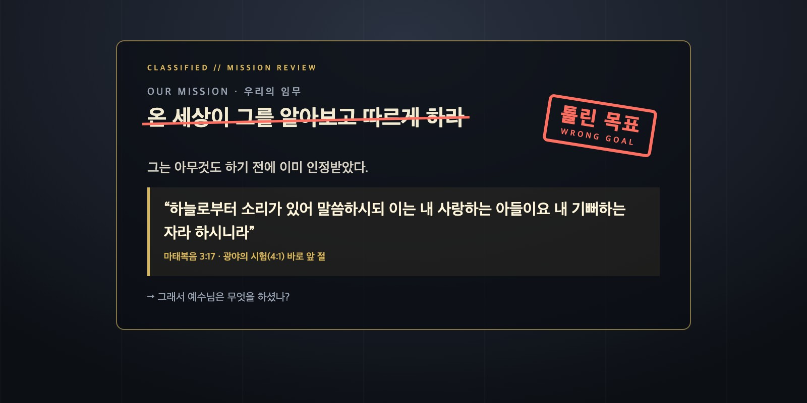

# 시험은 "내 사랑하는 아들"이라는 말 바로 다음에 온다 — 마태복음 3:17~4:11

Operation Zero · 작전명: 제로 · 역할극 · 학생 4~5명과 선생님 1명 · 설교 앞에 하는 활동 · 블로그 글: <https://salt-light.tistory.com/61>

A role-play before the sermon on Matthew 4: students are a strategy team hired to make an unknown man recognized by the whole world. Then they find out who already pitched the same plan, and that the mission itself was wrong.

마태복음 4장의 광야 시험을 펴기 전에, 바로 앞 절을 먼저 읽어 보세요. 3장 17절입니다. "이는 내 사랑하는 아들이요 내 기뻐하는 자라."

예수님이 이 말을 들으신 때는 아직 아무것도 하시기 전입니다. 병을 고치기 전, 가르치기 전, 제자를 부르기 전이에요. 그리고 바로 다음 장면에서 시험하는 자가 와서 말합니다. "네가 만일 하나님의 아들이어든."

이 순서 하나로 중고등부 아이들과 설교 앞에 하는 역할극을 만들었습니다.

## 준비물

브리핑 슬라이드 다섯 장, 학생 카드 여덟 쪽, 가면과 이름표. 학생 카드는 미션 브리핑 한 쪽, 역할 카드 다섯 쪽, 전략 메모 한 쪽, 「사탄의 전략」 한 쪽입니다. 마지막 쪽은 공개 전까지 나눠주지 마세요.

## 역할 나누기

- 선생님 = **비서실장**. 불을 낮추고, 낮고 진지한 목소리로 시작합니다.
- 학생 = **전략가**. 역할 카드는 다섯 장이고 학생 수만큼 나눠줍니다.

역할은 미디어·여론, 민생·구호, 권력·동맹, 이미지·브랜딩, 조직·동원 다섯 가지입니다. 카드마다 질문이 세 개씩 있어요. 민생·구호 전략가는 "배고픔, 빚, 질병 중 하나를 하룻밤에 끝낼 수 있다면 무엇을?"을, 미디어·여론 전략가는 "사람들이 '이건 진짜다'라고 단번에 믿게 할 눈앞의 증거는?"을, 권력·동맹 전략가는 "거래 하나로 10년 길을 1년으로 줄인다면, 무엇을 주고 무엇을 얻을까?"를 받습니다.

## 진행

먼저 의뢰인 프로필을 소리 내어 읽습니다.

- 평범한 30대 남자. 아직 아무도 모른다.
- 이제 그는 무엇이든 할 수 있다. 정말 무엇이든.
- 그가 절대적으로 믿는 목소리가 선언했다. "너는 온 세상을 이끌 사람이다."
- **임무: 온 세상이 그를 알아보고 따르게 하라.**

화면 속 의뢰인 사진은 선생님 자신입니다. 아이들이 웃거나 놀리게 두고, 선생님은 역할에서 나오지 않습니다.

그다음 역할 카드와 이름표, 가면을 나눠줍니다. **"가면 써. 지금부터 시간 잰다."** 혼자 4분 동안 작전을 짜고, 한 사람이 1분씩 발표합니다. 여기까지 성경 이야기는 한 마디도 하지 않습니다. 아이들은 그냥 이 사람을 유명하게 만드는 일에 몰두하면 돼요.

## 공개 하나: 누가 먼저 제안했나

발표가 끝나면 「사탄의 전략」을 띄웁니다. **"이걸 입수했다. 누군가 이미 우리 의뢰인에게 똑같은 수를 제안했다."**

- **A. 필요를 채워줘라.** "네가 만일 하나님의 아들이어든 명하여 이 돌들로 떡덩이가 되게 하라" (4:3)
- **B. 부정할 수 없는 증거 하나.** "네가 만일 하나님의 아들이어든 뛰어내리라" (4:6)
- **C. 정상으로 가는 지름길.** "만일 내게 엎드려 경배하면 이 모든 것을 네게 주리라" (4:9)

마태복음 4장 1-11절을 같이 읽고, 아이들이 발표한 작전을 하나씩 다시 불러서 A·B·C 중 어디에 붙는지 소리 내어 셉니다.

굶주림을 끝내자는 작전은 A로, 카메라 앞의 기적과 하늘에서 내려오는 등장은 B로, 힘센 나라와 손잡자는 작전은 C로 갑니다. **"우리 작전 ○개 중 ○개가 이미 그의 목록에 있었다."** 역할 카드의 질문이 이 셋과 겹치기 쉽게 짜여 있어서, 아이들이 열심히 답했을수록 많이 겹칠 겁니다. 오늘 수업의 절정이 여깁니다. 방금까지 자기가 낸 아이디어가 누구의 아이디어였는지 보게 되니까요.

## 공개 둘: 임무가 틀렸다

임무를 다시 띄웁니다. "온 세상이 그를 알아보고 따르게 하라." 그 위에 도장이 찍힙니다. **틀린 목표.**

그는 아무것도 하기 전에 이미 인정받았습니다.

> "하늘로부터 소리가 있어 말씀하시되 이는 내 사랑하는 아들이요 내 기뻐하는 자라 하시니라" (3:17)

광야의 시험은 이 말 바로 다음에 나옵니다. 세 제안 중 둘이 "네가 만일 하나님의 아들이어든"으로 시작해요. 이미 들은 말을 증명해 보이라는 겁니다.

## 물어볼 것

**"왜 우리가 짠 작전이 그의 제안이랑 겹칠까?"**

**"인정받으려는 노력은 언제 끝날까?"**

**"예수님은 3장 17절의 말을 듣기 위해 뭘 하셨지?"**

아이들이 "그럼 열심히 하는 건 나쁜 거네요"로 가면 4장 17절과 23절을 짚어주세요. 예수님은 시험 뒤에 전파하시고 가르치시고 고치셨습니다. 순서가 달랐을 뿐이에요. 3장 17절이 먼저였습니다. 그리고 답을 정리해 주지 않고 설교로 넘깁니다. **"그래서 예수님은 무엇을 하셨나?"**

## 자료

- [`operation-zero-briefing.pptx`](operation-zero-briefing.pptx): 브리핑 슬라이드 다섯 장(영문). 슬라이드마다 발표자 노트에 진행 대사가 있어요. 의뢰인 프로필의 사진 자리는 빈 실루엣으로 비워 두었으니 선생님 사진으로 바꿔 넣으세요.
- [`operation-zero-student-cards.pdf`](operation-zero-student-cards.pdf): 학생 카드 여덟 쪽(한/영, 레터 용지). 미션 브리핑의 "바로 여기 앤아버에 사는"은 우리 동네 이름으로 바꿔 말해 주세요.

그림 속 종이는 실제 학생 카드이고, 노란 쪽지의 작전은 예시입니다.

성경 본문: 성경전서 개역개정판 © 대한성서공회.
