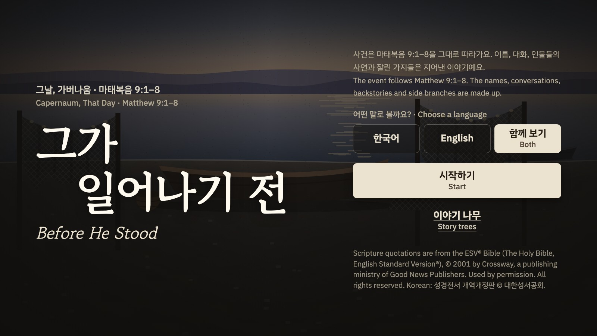
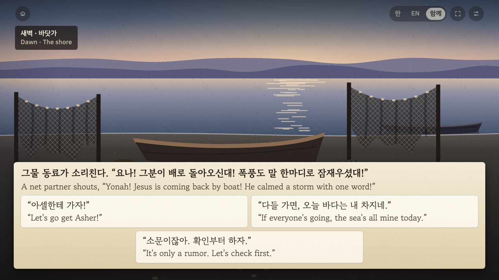
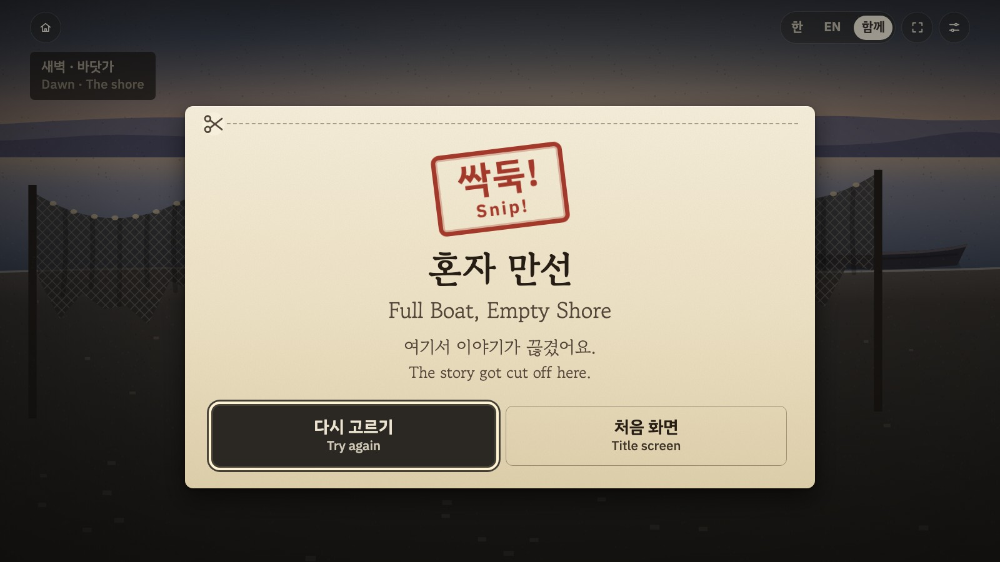
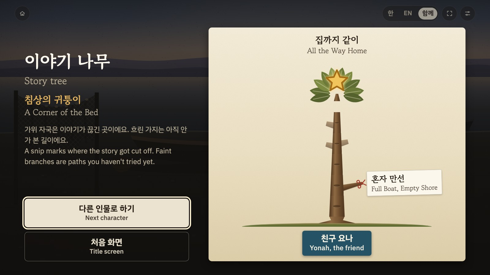

# "일어나라"보다 먼저 나온 말이 있다 — 마태복음 9:1~8

그가 일어나기 전 · Before He Stood · 이야기 게임(웹) · 약 20분 · 반 전체가 TV 한 대로 · 설교 앞에 하는 활동 · 블로그 글: <https://salt-light.tistory.com/62>

A bilingual story game on Matthew 9:1–8. The class plays three characters in turn on one TV, about five minutes each, before the sermon.

- **열기:** <https://bagmk.github.io/sunday-school/apps/before-he-stood/>
- **게임 폴더와 사용법:** [`apps/before-he-stood/`](../../apps/before-he-stood/)

마태복음 9장 1-8절에서 예수님이 중풍병자에게 하신 말을 순서대로 적어 보세요.

첫마디는 "일어나라"가 아닙니다. "작은 자야 안심하라 네 죄 사함을 받았느니라"(9:2)입니다. "일어나 네 침상을 가지고 집으로 가라"는 6절에 가서야 나와요. 그날 가장 중요한 말은 그가 일어나기 전에 나왔습니다.

이 순서 하나로 중고등부 아이들과 TV 한 대로 같이 하는 20분짜리 이야기 게임을 만들었습니다. 제목도 거기서 왔어요. 「그가 일어나기 전」.

## 준비물

컴퓨터와 TV 한 대. 인쇄할 것은 없습니다. 주소를 열고 「함께 보기」를 고르면 한국어와 영어가 같이 나와요. 인터넷이 없는 곳에서는 파일을 받아 `index.html`을 더블클릭하면 됩니다.

## 세 사람

같은 날을 세 사람의 눈으로 차례로 따라갑니다.

- **서기관 므나헴.** 아침에 시편을 읽은 서기관이 그날 바닷가에서 그 말씀을 다시 만납니다.
- **친구 요나.** 네 해째 누워 지내는 친구를 침상째 들고 예수님께 갑니다.
- **침상의 아셀.** 침상에 누운 채 실려 가서, 처음 듣는 말을 듣습니다.

이름과 대화, 이전 이야기는 지어낸 것입니다. 사건은 본문을 따르고, 예수님의 말씀은 개역개정과 ESV 본문 그대로만 나옵니다. 예수님의 얼굴은 그리지 않고 빛으로만 보여요.

## 진행

**서기관 → 친구 → 아셀** 순서로 합니다. 서기관의 속생각이 다른 두 이야기에서 대답으로 돌아오고, 아셀이 일어나는 장면이 마지막에 오거든요. 인물 하나에 소리 내어 읽기로 5분쯤, 셋을 다 하면 20분 안에 끝납니다.

화면의 글은 아이들이 돌아가며 소리 내어 읽고, 보기는 반 전체가 같이 고릅니다.

친구 요나의 첫 장면입니다. 그물 동료가 소리칩니다. "요나! 그분이 배로 돌아오신대! 폭풍도 말 한마디로 잠재우셨대!" 보기는 셋이에요. "아셀한테 가자!", "다들 가면, 오늘 바다는 내 차지네.", "소문이잖아. 확인부터 하자."

## 핵심: 엉뚱한 보기를 고르면 이야기가 잘립니다

아이들은 일부러 웃긴 보기를 고를 겁니다. 그래도 됩니다. 선택은 사건을 바꾸지 못하거든요. 예수님은 그날 그 말씀을 하시고, 그 사람은 일어납니다. 선택이 정하는 것은 주인공이 그 이야기 안에 남아 있느냐입니다.

"오늘 바다는 내 차지네"를 고르면 요나는 혼자 고기를 잡으러 갑니다. 짧은 장면 뒤에 **「싹둑!」** 도장이 찍히고 이야기가 끊겨요. 배는 가득 찼는데 그 자리에 없었던 겁니다. 「다시 고르기」를 누르면 그 선택으로 돌아갑니다.

"확인부터 하자"를 고르면 동료들이 "확인하다가 배 떠난다!" 하고 막습니다. 그 보기는 사라지고, 남은 보기에서 다시 골라요.

인물마다 엔딩은 하나입니다. 끝까지 가면 그 인물의 암송 구절이 나오고 이야기가 끝납니다.

## 끝나면 이야기 나무

인물 하나가 끝날 때마다 이야기 나무가 나옵니다. 줄기 끝의 별이 그 인물의 엔딩이고, 가위 자국이 난 가지는 오늘 우리 반이 잘라 먹은 이야기예요. 아직 못 본 가지는 흐리게 자리만 보입니다. 세 사람을 다 하고 나면 그날 우리 반이 어디서 웃었는지가 나무 세 그루로 남습니다.

## 물어볼 것

**"예수님은 왜 '일어나라'보다 '네 죄 사함을 받았느니라'를 먼저 말씀하셨을까?"**

답을 정리해 주지 않고 설교(마 8:23–9:8)로 넘깁니다.

리모컨 조작, 오프라인 실행, 내용 고치는 방법은 [게임 README](../../apps/before-he-stood/README.md)에 있습니다. 그림은 실제 게임 화면입니다.

성경 본문: 성경전서 개역개정판 © 대한성서공회.
