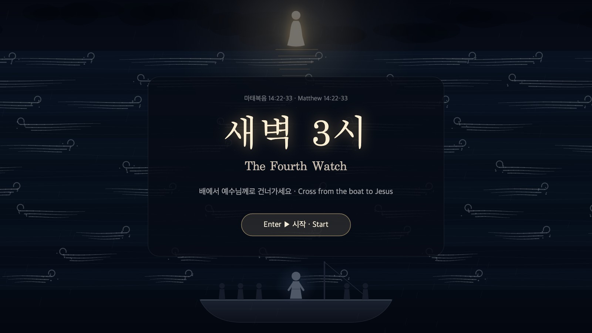
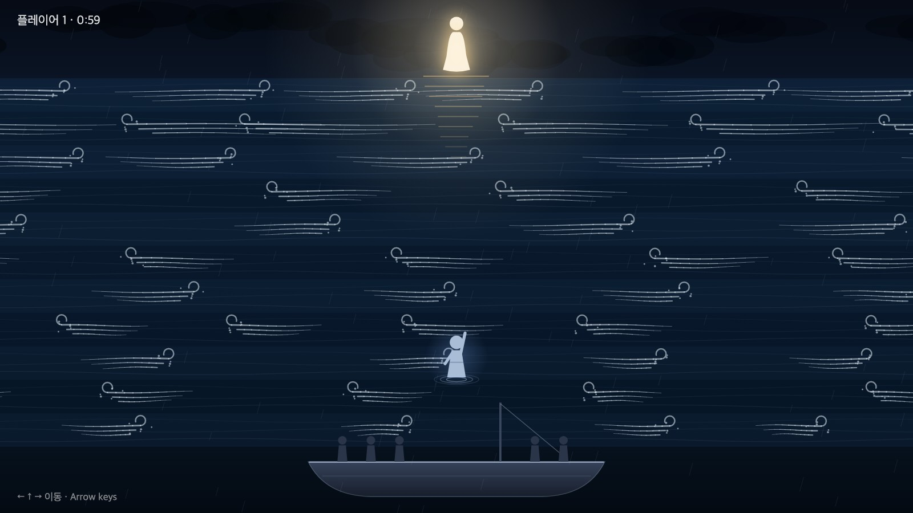
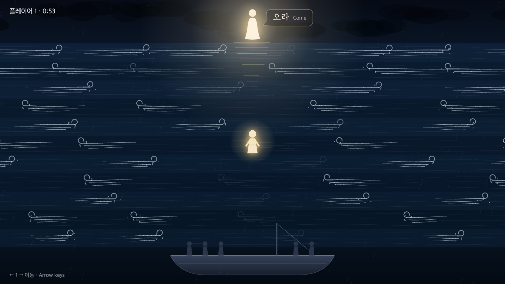
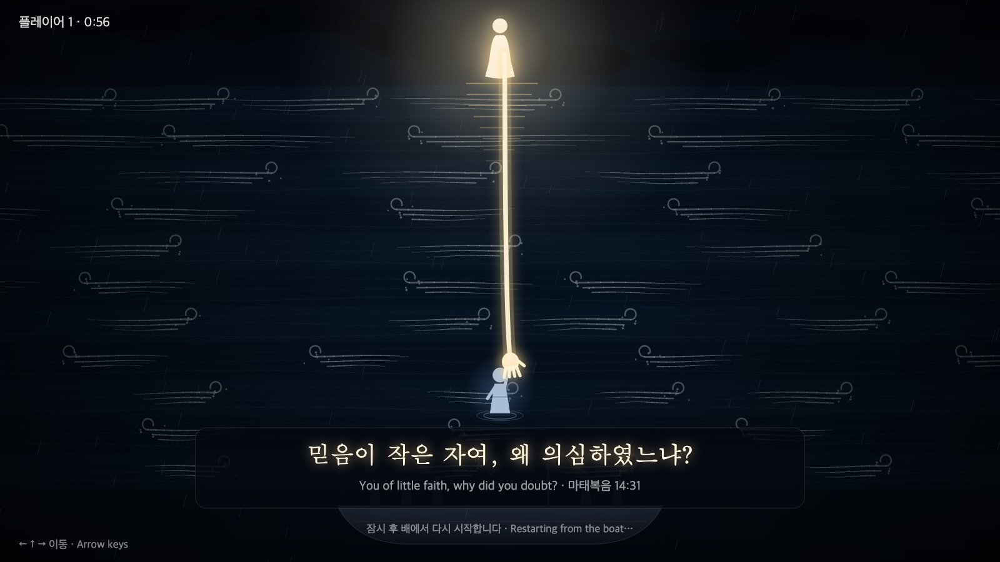
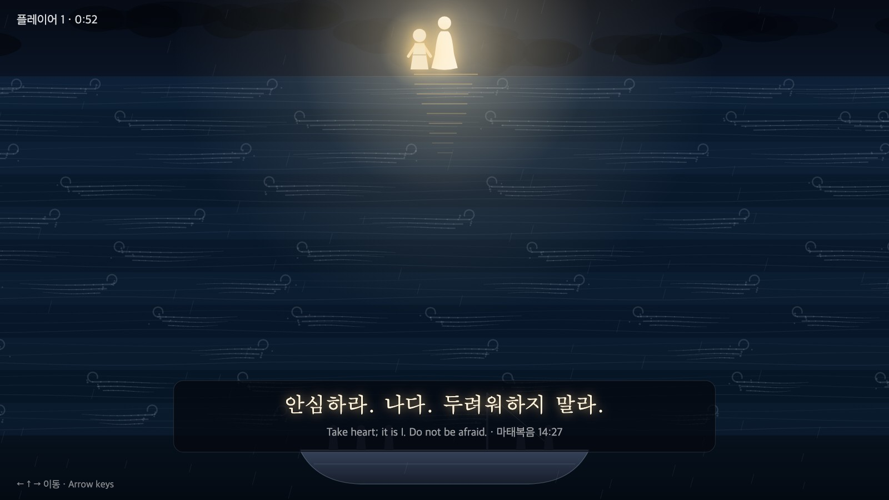
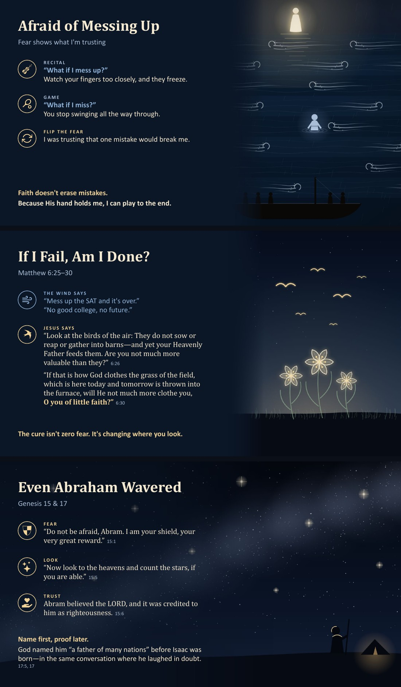

# 베드로는 물이 아니라 바람을 보고 빠졌다 — 마태복음 14:22~33

새벽 3시 · The Fourth Watch · 건너기 게임(웹) · 20분 · 학생 4~5명과 선생님 1명 · 노트북과 프로젝터

A Frogger-style game on Matthew 14:22–33 with a rule only the teacher knows: dodging the wind never gets Peter across, but stepping out when Jesus says "Come" does.

- **열기:** <https://bagmk.github.io/sunday-school/apps/fourth-watch/> (휴대폰: [mobile.html](https://bagmk.github.io/sunday-school/apps/fourth-watch/mobile.html))
- **게임 폴더와 선생님용 조작법:** [`apps/fourth-watch/`](../../apps/fourth-watch/)

마태복음 14장 30절에서 베드로가 무엇을 보고 무서워했는지 찾아보세요.

물이 아닙니다. 바람입니다. "바람을 보고 무서워 빠져 가는지라." 물 위는 이미 걷고 있었어요. 한 절 앞에서 예수님이 "오라" 하셨고, 베드로는 배에서 내려 물 위로 걸어갔습니다(14:29).

이 관찰 하나로 중고등부 아이들과 20분짜리 건너기 게임을 만들었습니다.

## 준비물

노트북과 프로젝터. 인쇄할 것은 없습니다. 주소를 열고 `Enter`를 누르면 시작해요. 휴대폰으로 하는 세로 화면 버전도 있습니다.

## 진행

학생이 한 사람씩 60초 동안 합니다. 바람을 피해 배에서 예수님께로 건너가는 게임이라고만 말해 주세요.

아이들은 바람 사이의 빈틈을 보며 한 줄씩 올라갑니다. 처음 몇 줄은 바람이 느려서 쉽게 가요. 해 볼 만해 보입니다. 그런데 예수님께 가까워질수록 바람이 빨라지고 촘촘해져서, 조심스럽게 하는 아이는 거의 다 아홉째나 열째 줄에서 빠집니다.

## 핵심: 규칙 하나를 숨겼습니다

아이들에게는 말하지 않습니다. 화면 어디에도 안내가 없어요.

숨겨진 규칙 (선생님만 보세요)

약 10초마다 예수님 옆에 **「오라 · Come」** 말풍선이 2.5초 동안 조용히 떴다 사라집니다. 그때 ↑를 멈추지 않고 누르면 베드로가 파도를 넘어 곧장 걸어갑니다. 바람이 닿지 않아요.

세 번째로 연달아 누를 때부터 베드로가 금빛으로 빛납니다. 멈추거나 옆으로 피하면 '바람을 본 것'이에요. 그때부터 다시 바람에 닿고, 보통 곧 빠집니다. 14장 29절과 30절이 그대로 규칙입니다.

바람을 잘 피하는 것이 답이라고 믿고 시작한 아이는 말풍선을 보지 못합니다. 바람만 보고 있으니까요.

## 빠져도 끝나지 않습니다

빠지면 베드로가 "주여 나를 구원하소서" 하고 외칩니다. 빛의 손이 내려와 붙잡고, "믿음이 작은 자여 왜 의심하였느냐"(14:31)가 나온 뒤 배에서 다시 시작해요. 60초 동안 몇 번이든 그렇습니다. 화면에 「Game Over」는 한 번도 나오지 않습니다.

## 선생님 차례

아이들이 다 한 뒤에 선생님이 마지막으로 합니다. 「오라」가 뜰 때까지 배에서 기다렸다가, 뜨면 ↑를 멈추지 않고 눌러 건너세요.

아이들이 "어떻게 했어요?" 하고 물을 겁니다. 오늘 수업의 절정이 여깁니다. 바로 답하지 말고 되물어 주세요.

**"저 말풍선, 아까 너희가 할 때도 떠 있었어. 본 사람?"**

수업 전에 꼭 직접 연습해 보세요. `D`를 누르면 리허설용 화면이 켜집니다.

## 게임 뒤 슬라이드

게임 뒤에는 세 장으로 이야기를 잇습니다.

**두려움은 내가 무엇을 믿고 있는지 보여준다.** 연주회에서 "틀리면 어쩌지?" 하고 손가락만 보면 손이 굳습니다. 뒤집어 보면, 나는 실수 한 번이 나를 무너뜨린다고 믿고 있었던 거예요.

**실패하면 끝일까?** 바람은 "SAT 망치면 끝이야"라고 말합니다. 예수님은 "공중의 새를 보라 … 너희는 이것들보다 귀하지 아니하냐"(마 6:26)라고 하십니다. 약은 두려움이 0이 되는 것이 아니라 보는 곳을 바꾸는 것입니다.

**아브라함도 흔들렸다.** 하나님은 이삭이 태어나기 전에, 아브라함이 의심하며 웃던 바로 그 대화에서 그를 "여러 민족의 아버지"라 부르셨습니다(창 17:5, 17). 이름이 먼저였고 증거는 나중이었어요.

## 물어볼 것

**"아까 게임할 때 뭘 보고 있었어?"**

**"요즘 너한테 제일 세게 부는 바람은 뭐야? 그 바람은 너한테 뭐라고 말해?"**

아이들이 "그럼 믿음만 있으면 안 빠지는 거네요"로 가면 14장 31절을 짚어주세요. 베드로는 빠졌고, 예수님은 "즉시 손을 내밀어" 붙잡으셨습니다. 게임에서도 빠질 때마다 손이 먼저 왔어요.

## 자료

- [`after-game-slides.pdf`](after-game-slides.pdf): 게임 뒤 슬라이드 여섯 쪽(영문). 앞 세 쪽은 도입 화면이고 뒤 세 쪽은 내용이 채워진 화면이에요.
- [`design-prompt.md`](design-prompt.md): 이 게임을 만들 때 쓴 첫 설계서(영문)입니다. 여덟 줄 바다와 '꾹 누르기' 조작으로 시작했고, 만들면서 고쳐서 지금은 열한 줄 바다와 '멈추지 않고 누르기'가 됐어요. 지금 규칙은 게임 README를 따르세요.

성경 본문: 성경전서 개역개정판 © 대한성서공회.

그림은 실제 게임 화면과 게임 뒤 슬라이드입니다.
